# A3 课程 Benchmark：18 个场景图鉴与运行命令

本文基于当前 `course-v1`，涵盖 14 种基础任务和 4 种 Bonus。每个场景提供两张真实 MuJoCo 初始截图、单项测试命令和带 `--render` 的单回合专家演示命令。标准化任务组把两个标准布局分别按三个档位评测，共 22 个任务与档位组合、140 回合。

- **截图条件：** `seed=0`；标准 `2x5`、`2x10` 使用 `advanced`，其余场景使用 `basic`。截图是在初始化和物理沉降后、专家开始执行前采集的；图中视角用于展示，不是策略相机。倾斜场景的白蓝标记仅用于标识物体。
- **统一提示词：** `Fill the target box.`；ACT 不使用文本，但结果仍记录该提示词。
- **评分：** 2×5 目标盒两列各 5 块；2×10 两列各 10 块；双盒各 5 块。物体必须直立、稳定，并从左右夹爪释放。来源列、原预填物身份和源盒剩余数量仅作诊断。扩展场景使用 basic、只按目标状态判成功，与 PDF 部分规则不同。
- **步数与结果：** 默认上限 2×5 为 6000 步、2×10 为 12000 步。标准布局的示例测试命令按 advanced 运行 10 回合，其余场景各运行 5 回合，结果写入 `outputs/course_tests/`；演示命令运行 1 回合并写入 `outputs/course_demos/`。`expert` 是读取模拟器特权状态的规则控制器，并非训练模型。不同种子不保证成功。

## 运行前

在已安装本项目依赖的 Python 环境中，先进入项目的任意子目录，再运行：

```bash
cd "$(git rev-parse --show-toplevel)"
export OPENBLAS_NUM_THREADS=1 OMP_NUM_THREADS=1
```

`--render` 使用 MuJoCo/GLFW 图形窗口，需可用的图形桌面和 `DISPLAY`；纯 SSH 或无桌面环境可先运行无窗口测试，或配置可用的图形显示。`MUJOCO_GL=egl` 可用于离屏渲染，但本身不能替代可显示的窗口。演示统一设置 `--workers 1`，可以用鼠标调整窗口视角。截图是静态初态；演示会真实执行专家动作。

标准布局的完整评估还需将对应命令中的 `--profile advanced` 分别改为 `basic` 和 `medium`，各运行 10 回合，并为不同档位指定不同的 `--output` 路径。也可直接执行[课程任务组](../course_benchmark.md)的 140 回合并保存结果：

```bash
MUJOCO_GL=egl python -m a3_dual_arm_sim.workflows.course_benchmark_cli \
  --policy expert --seed-start 0 --output outputs/course_benchmark/expert_seed0.json
```

下列测试命令默认评测 `expert`。若要测自己训练的策略，可将 `--policy expert` 替换为例如 `--policy smolvla:/绝对路径/pretrained_model` 或 `--policy act:/绝对路径/pretrained_model`，并按项目说明提供对应依赖和数据配置；路径需要替换为真实检查点。

截图的实际初态、档位和源码指纹记录在 [截图清单](screenshots_manifest.json)。如需用仓库已有生成器重新生成到本图鉴目录，可在仓库根目录运行：

```bash
MUJOCO_GL=egl python - <<'PYCODE'
from pathlib import Path
from runpy import run_path

scope = run_path("src/a3_dual_arm_sim/course_visual_guide/generate_screenshots.py")
main = scope["main"]
main.__globals__["ROOT"] = Path("docs/course_visual_guide")
main.__globals__["IMAGES"] = Path("docs/course_visual_guide/images")
main()
PYCODE
```

## 01. 标准搬运 2×5（2x5）

**基础 01/14** · seed=0 · advanced · 源盒 80 块 · 目标盒 0 块

源盒完整；目标盒最终两列各放 5 块。 图中源盒初始有 80 块，目标盒初始为空。

**实际提示词：** `Fill the target box.`

| 工作区全景 | 源盒细节 |
| :---: | :---: |
|  | 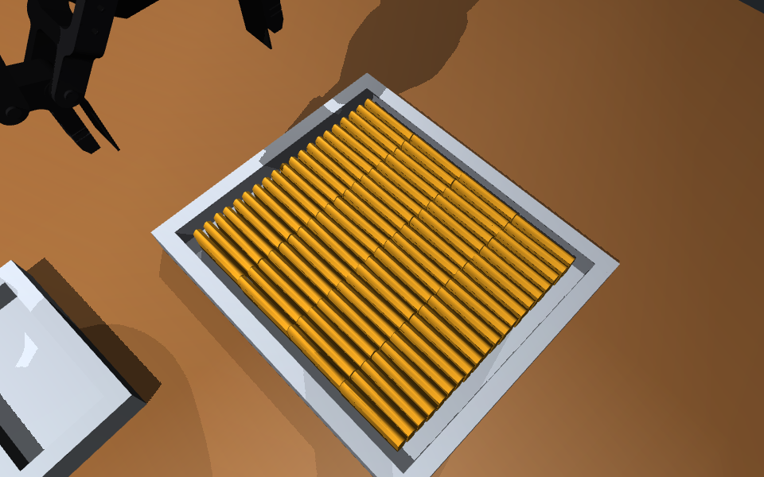 |

**10 回合测试（advanced）：**

```bash
MUJOCO_GL=egl python -m a3_dual_arm_sim.workflows.benchmark_cookie_batch_cli \
  --task 2x5 --protocol course-v1 \
  --policy expert --profile advanced --episodes 10 --seed-start 0 \
  --workers 1 --output outputs/course_tests/2x5_advanced.json
```

**渲染专家演示：**

```bash
MUJOCO_GL=egl python -m a3_dual_arm_sim.workflows.benchmark_cookie_batch_cli \
  --task 2x5 --protocol course-v1 \
  --policy expert --profile advanced --episodes 1 --seed-start 0 \
  --workers 1 --render --output outputs/course_demos/2x5.json
```

## 02. 标准搬运 2×10（2x10）

**基础 02/14** · seed=0 · advanced · 源盒 80 块 · 目标盒 0 块

源盒完整；目标盒最终两列各放 10 块。 图中源盒初始有 80 块，目标盒初始为空。

**实际提示词：** `Fill the target box.`

| 工作区全景 | 源盒细节 |
| :---: | :---: |
| 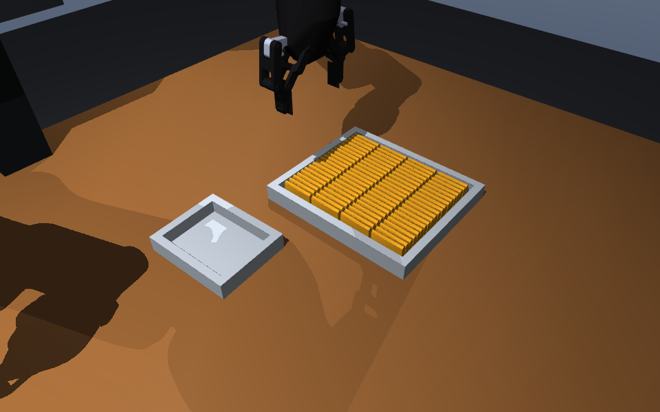 | 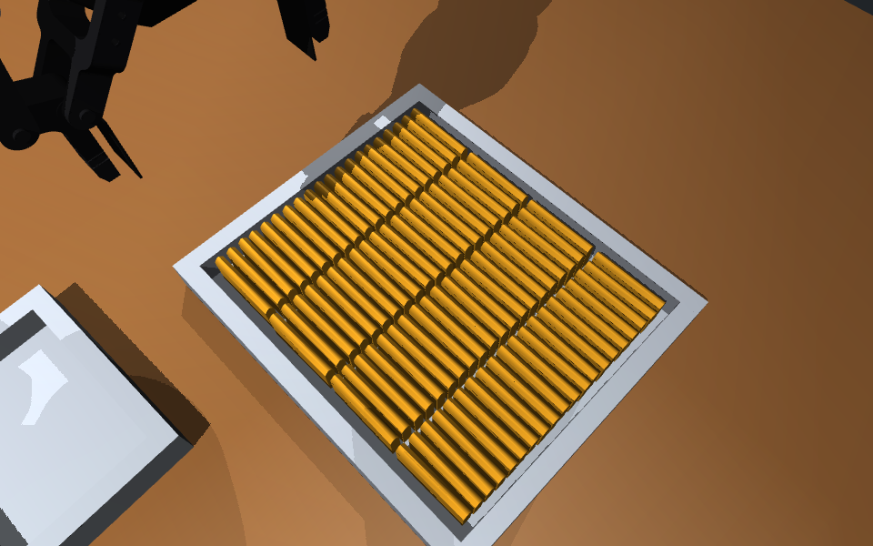 |

**10 回合测试（advanced）：**

```bash
MUJOCO_GL=egl python -m a3_dual_arm_sim.workflows.benchmark_cookie_batch_cli \
  --task 2x10 --protocol course-v1 \
  --policy expert --profile advanced --episodes 10 --seed-start 0 \
  --workers 1 --output outputs/course_tests/2x10_advanced.json
```

**渲染专家演示：**

```bash
MUJOCO_GL=egl python -m a3_dual_arm_sim.workflows.benchmark_cookie_batch_cli \
  --task 2x10 --protocol course-v1 \
  --policy expert --profile advanced --episodes 1 --seed-start 0 \
  --workers 1 --render --output outputs/course_demos/2x10.json
```

## 03. 缺失整列 2×5（missing-columns）

**基础 03/14** · seed=0 · basic · 源盒 40 块 · 目标盒 0 块

随机移除 1 或 2 个源列；从剩余物体中填满 2×5 目标盒。 图中移除源列：1、3。

**实际提示词：** `Fill the target box.`

| 工作区全景 | 源盒细节 |
| :---: | :---: |
| 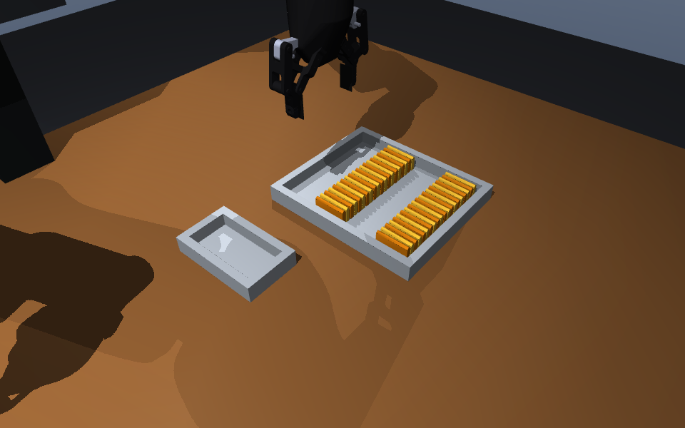 | 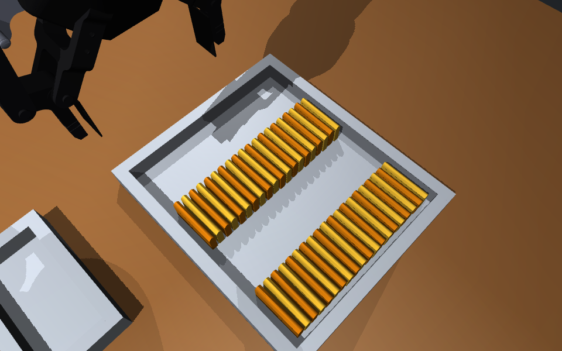 |

**5 回合测试：**

```bash
MUJOCO_GL=egl python -m a3_dual_arm_sim.workflows.benchmark_cookie_batch_cli \
  --task missing-columns --protocol course-v1 \
  --policy expert --profile basic --episodes 5 --seed-start 0 \
  --workers 1 --output outputs/course_tests/missing-columns.json
```

**渲染专家演示：**

```bash
MUJOCO_GL=egl python -m a3_dual_arm_sim.workflows.benchmark_cookie_batch_cli \
  --task missing-columns --protocol course-v1 \
  --policy expert --profile basic --episodes 1 --seed-start 0 \
  --workers 1 --render --output outputs/course_demos/missing-columns.json
```

## 04. 缺失整列 2×10（2x10-missing-columns）

**基础 04/14** · seed=0 · basic · 源盒 40 块 · 目标盒 0 块

随机移除 1 或 2 个源列；从剩余物体中填满 2×10 目标盒。 图中移除源列：1、3。

**实际提示词：** `Fill the target box.`

| 工作区全景 | 源盒细节 |
| :---: | :---: |
| 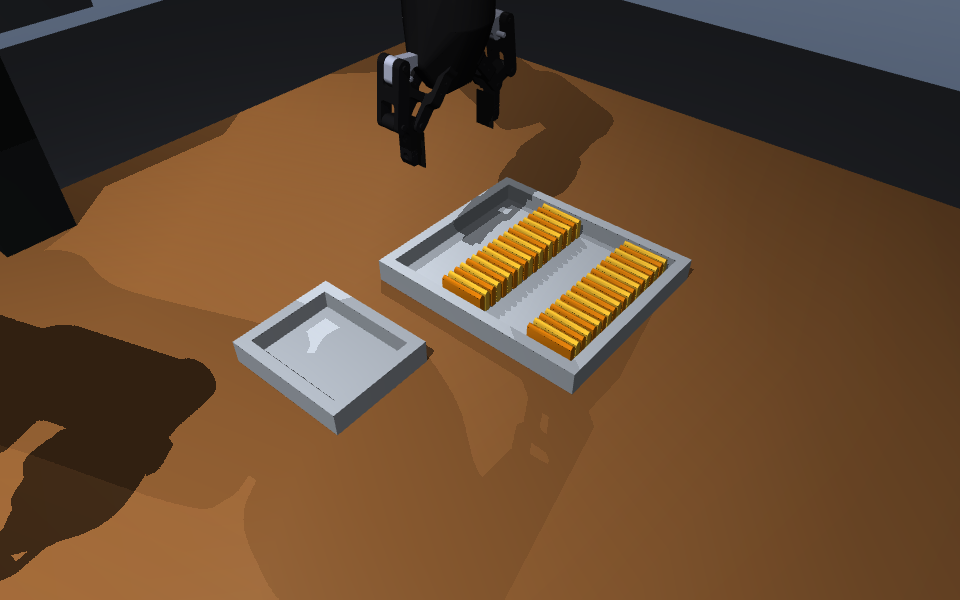 | 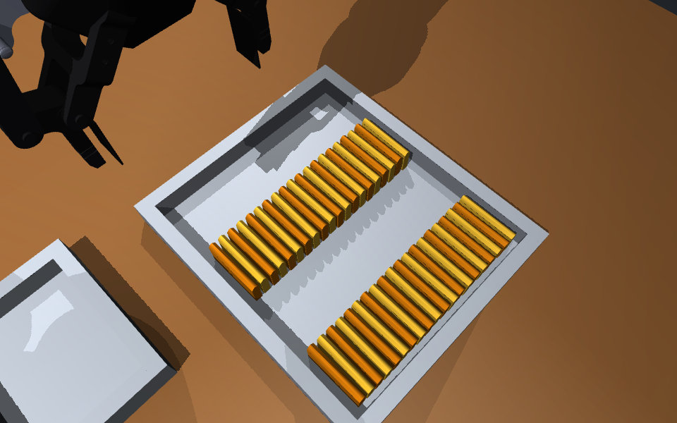 |

**5 回合测试：**

```bash
MUJOCO_GL=egl python -m a3_dual_arm_sim.workflows.benchmark_cookie_batch_cli \
  --task 2x10-missing-columns --protocol course-v1 \
  --policy expert --profile basic --episodes 5 --seed-start 0 \
  --workers 1 --output outputs/course_tests/2x10-missing-columns.json
```

**渲染专家演示：**

```bash
MUJOCO_GL=egl python -m a3_dual_arm_sim.workflows.benchmark_cookie_batch_cli \
  --task 2x10-missing-columns --protocol course-v1 \
  --policy expert --profile basic --episodes 1 --seed-start 0 \
  --workers 1 --render --output outputs/course_demos/2x10-missing-columns.json
```

## 05. 局部缺口 2×5（partial-gaps）

**基础 05/14** · seed=0 · basic · 源盒 56 块 · 目标盒 0 块

每个源列的前端和内部均有缺口，使用剩余物体填满 2×5 目标盒。 图中每列移除的行号（从 1 计）：1、2、3、10、11、12。

**实际提示词：** `Fill the target box.`

| 工作区全景 | 源盒细节 |
| :---: | :---: |
| 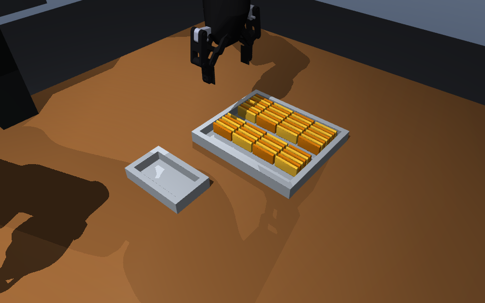 | 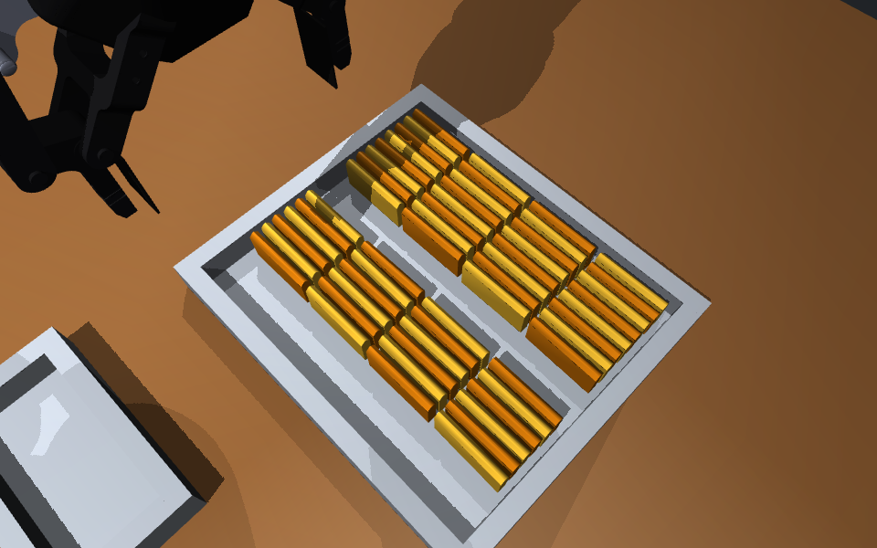 |

**5 回合测试：**

```bash
MUJOCO_GL=egl python -m a3_dual_arm_sim.workflows.benchmark_cookie_batch_cli \
  --task partial-gaps --protocol course-v1 \
  --policy expert --profile basic --episodes 5 --seed-start 0 \
  --workers 1 --output outputs/course_tests/partial-gaps.json
```

**渲染专家演示：**

```bash
MUJOCO_GL=egl python -m a3_dual_arm_sim.workflows.benchmark_cookie_batch_cli \
  --task partial-gaps --protocol course-v1 \
  --policy expert --profile basic --episodes 1 --seed-start 0 \
  --workers 1 --render --output outputs/course_demos/partial-gaps.json
```

## 06. 局部缺口 2×10（2x10-partial-gaps）

**基础 06/14** · seed=0 · basic · 源盒 56 块 · 目标盒 0 块

每个源列的前端和内部均有缺口，使用剩余物体填满 2×10 目标盒。 图中每列移除的行号（从 1 计）：1、2、3、10、11、12。

**实际提示词：** `Fill the target box.`

| 工作区全景 | 源盒细节 |
| :---: | :---: |
| 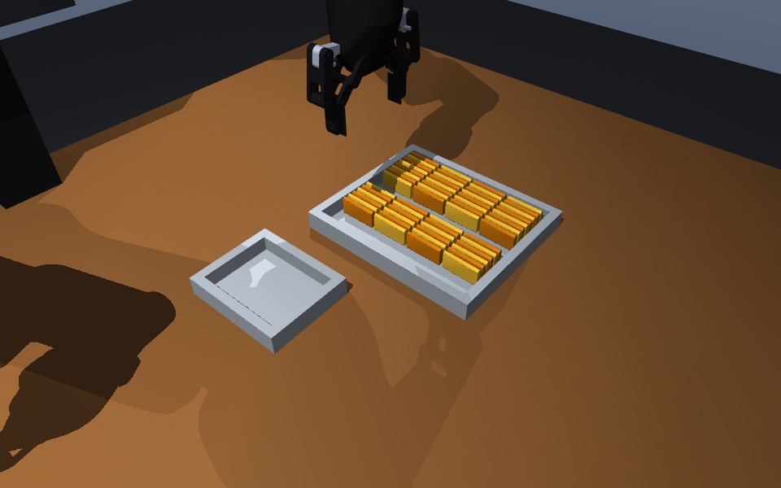 | 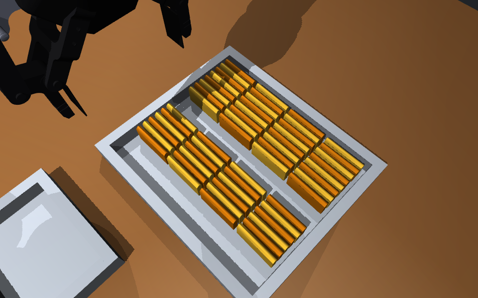 |

**5 回合测试：**

```bash
MUJOCO_GL=egl python -m a3_dual_arm_sim.workflows.benchmark_cookie_batch_cli \
  --task 2x10-partial-gaps --protocol course-v1 \
  --policy expert --profile basic --episodes 5 --seed-start 0 \
  --workers 1 --output outputs/course_tests/2x10-partial-gaps.json
```

**渲染专家演示：**

```bash
MUJOCO_GL=egl python -m a3_dual_arm_sim.workflows.benchmark_cookie_batch_cli \
  --task 2x10-partial-gaps --protocol course-v1 \
  --policy expert --profile basic --episodes 1 --seed-start 0 \
  --workers 1 --render --output outputs/course_demos/2x10-partial-gaps.json
```

## 07. 跨列取料 2×5（cross-column）

**基础 07/14** · seed=0 · basic · 源盒 32 块 · 目标盒 0 块

四个源列各保留连续 8 块，目标是直立放入 10 块。 图中四列保留段的起始行（从 1 计）：9、12、1、8。

**实际提示词：** `Fill the target box.`

| 工作区全景 | 源盒细节 |
| :---: | :---: |
| 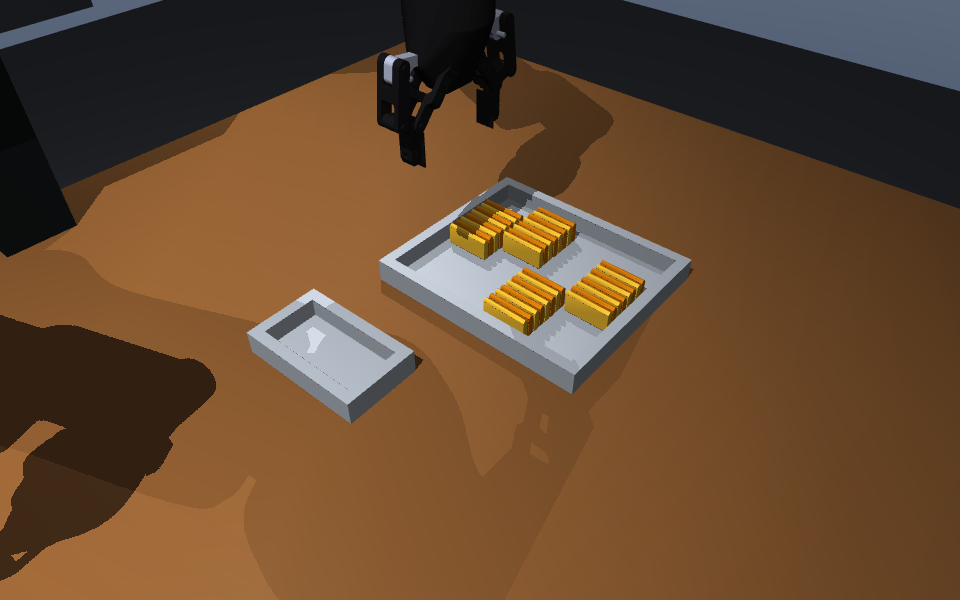 | 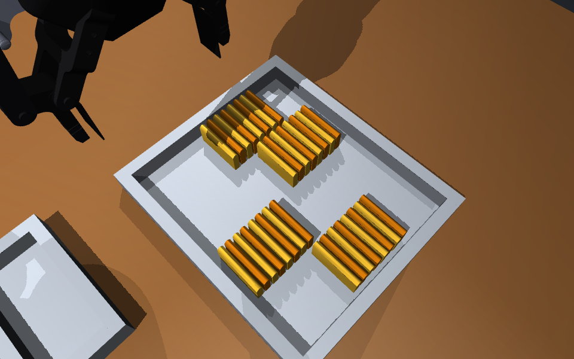 |

**5 回合测试：**

```bash
MUJOCO_GL=egl python -m a3_dual_arm_sim.workflows.benchmark_cookie_batch_cli \
  --task cross-column --protocol course-v1 \
  --policy expert --profile basic --episodes 5 --seed-start 0 \
  --workers 1 --output outputs/course_tests/cross-column.json
```

**渲染专家演示：**

```bash
MUJOCO_GL=egl python -m a3_dual_arm_sim.workflows.benchmark_cookie_batch_cli \
  --task cross-column --protocol course-v1 \
  --policy expert --profile basic --episodes 1 --seed-start 0 \
  --workers 1 --render --output outputs/course_demos/cross-column.json
```

## 08. 跨列取料 2×10（2x10-cross-column）

**基础 08/14** · seed=0 · basic · 源盒 32 块 · 目标盒 0 块

四个源列各保留连续 8 块，目标是直立放入 20 块。 图中四列保留段的起始行（从 1 计）：9、12、1、8。

**实际提示词：** `Fill the target box.`

| 工作区全景 | 源盒细节 |
| :---: | :---: |
| 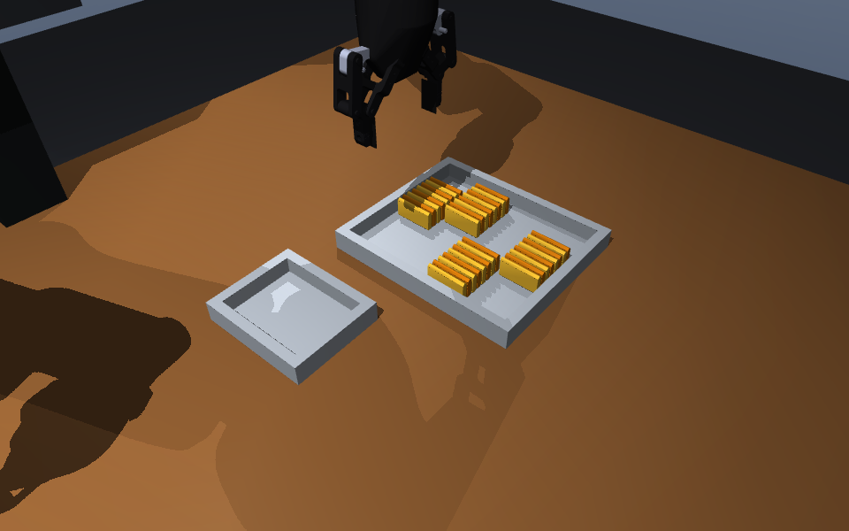 | 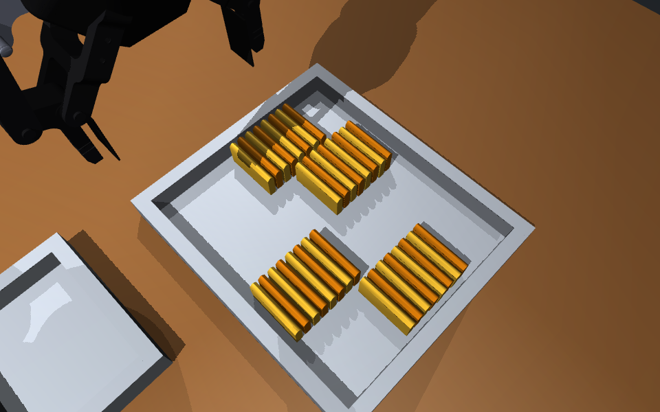 |

**5 回合测试：**

```bash
MUJOCO_GL=egl python -m a3_dual_arm_sim.workflows.benchmark_cookie_batch_cli \
  --task 2x10-cross-column --protocol course-v1 \
  --policy expert --profile basic --episodes 5 --seed-start 0 \
  --workers 1 --output outputs/course_tests/2x10-cross-column.json
```

**渲染专家演示：**

```bash
MUJOCO_GL=egl python -m a3_dual_arm_sim.workflows.benchmark_cookie_batch_cli \
  --task 2x10-cross-column --protocol course-v1 \
  --policy expert --profile basic --episodes 1 --seed-start 0 \
  --workers 1 --render --output outputs/course_demos/2x10-cross-column.json
```

## 09. 稀疏精确清空 2×5（sparse-exact-ten）

**基础 09/14** · seed=0 · basic · 源盒 10 块 · 目标盒 0 块

四列分别保留 1、2、3、4 块，共 10 块，目标盒最终两列各 5 块。 图中源列数量（源盒局部 X 从小到大）：4、2、1、3。

**实际提示词：** `Fill the target box.`

| 工作区全景 | 源盒细节 |
| :---: | :---: |
| 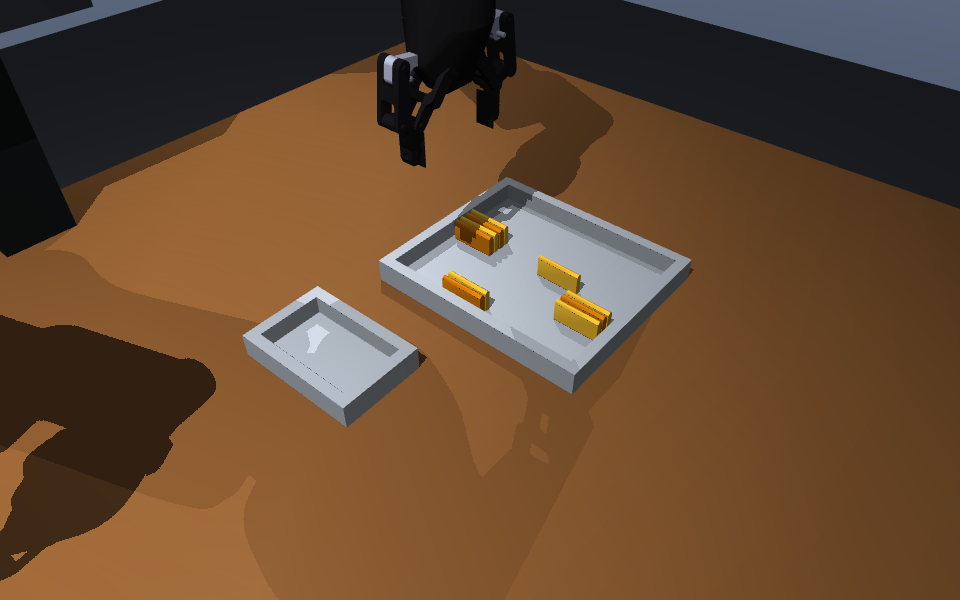 | 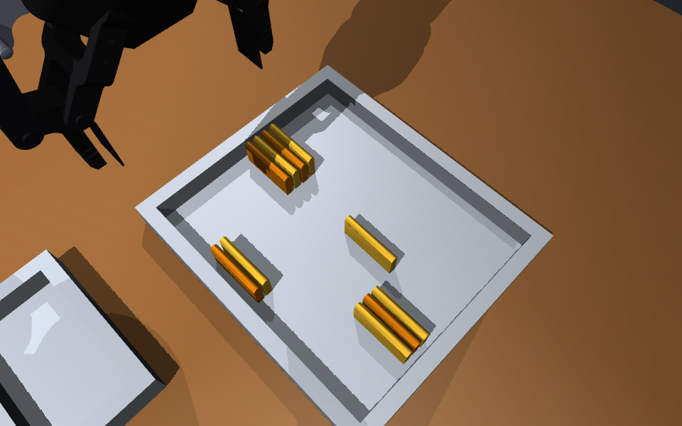 |

**5 回合测试：**

```bash
MUJOCO_GL=egl python -m a3_dual_arm_sim.workflows.benchmark_cookie_batch_cli \
  --task sparse-exact-ten --protocol course-v1 \
  --policy expert --profile basic --episodes 5 --seed-start 0 \
  --workers 1 --output outputs/course_tests/sparse-exact-ten.json
```

**渲染专家演示：**

```bash
MUJOCO_GL=egl python -m a3_dual_arm_sim.workflows.benchmark_cookie_batch_cli \
  --task sparse-exact-ten --protocol course-v1 \
  --policy expert --profile basic --episodes 1 --seed-start 0 \
  --workers 1 --render --output outputs/course_demos/sparse-exact-ten.json
```

## 10. 稀疏精确清空 2×10（2x10-sparse-exact-twenty）

**基础 10/14** · seed=0 · basic · 源盒 20 块 · 目标盒 0 块

四列分别保留 2、4、6、8 块，共 20 块，目标盒最终两列各 10 块。 图中源列数量（源盒局部 X 从小到大）：8、4、2、6。

**实际提示词：** `Fill the target box.`

| 工作区全景 | 源盒细节 |
| :---: | :---: |
| 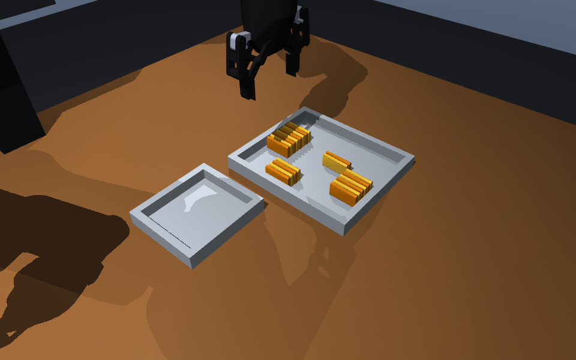 | 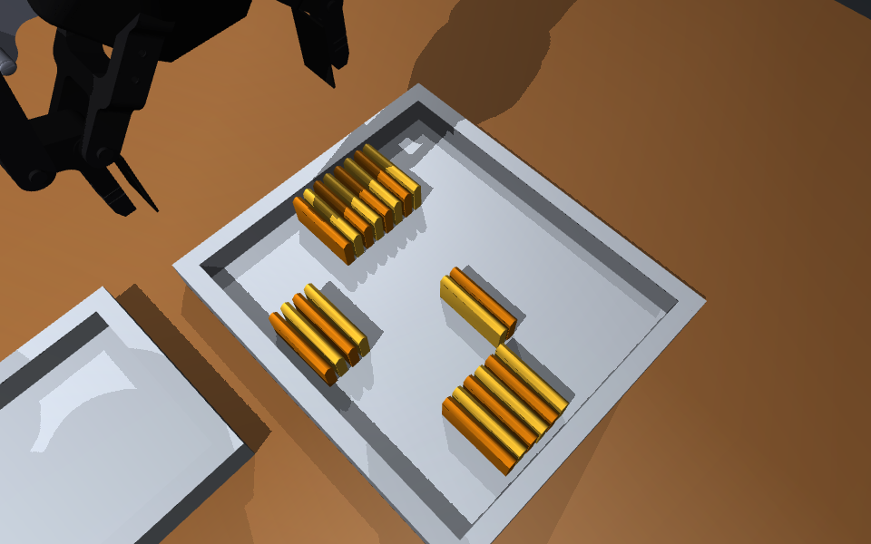 |

**5 回合测试：**

```bash
MUJOCO_GL=egl python -m a3_dual_arm_sim.workflows.benchmark_cookie_batch_cli \
  --task 2x10-sparse-exact-twenty --protocol course-v1 \
  --policy expert --profile basic --episodes 5 --seed-start 0 \
  --workers 1 --output outputs/course_tests/2x10-sparse-exact-twenty.json
```

**渲染专家演示：**

```bash
MUJOCO_GL=egl python -m a3_dual_arm_sim.workflows.benchmark_cookie_batch_cli \
  --task 2x10-sparse-exact-twenty --protocol course-v1 \
  --policy expert --profile basic --episodes 1 --seed-start 0 \
  --workers 1 --render --output outputs/course_demos/2x10-sparse-exact-twenty.json
```

## 11. 局部倾斜 2×5（tilted）

**基础 11/14** · seed=0 · basic · 源盒 80 块 · 目标盒 0 块

两列各有一块倾斜物体；目标盒最终两列各 5 块，评分不要求必须抓取倾斜物。 图中标记了倾斜饼干，沉降后角度约 14.1°、13.8°。

**实际提示词：** `Fill the target box.`

| 工作区全景 | 源盒倾斜细节 |
| :---: | :---: |
| 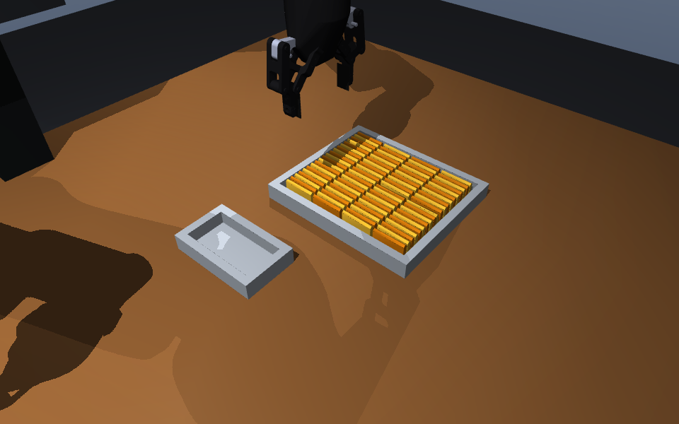 |  |

**5 回合测试：**

```bash
MUJOCO_GL=egl python -m a3_dual_arm_sim.workflows.benchmark_cookie_batch_cli \
  --task tilted --protocol course-v1 \
  --policy expert --profile basic --episodes 5 --seed-start 0 \
  --workers 1 --output outputs/course_tests/tilted.json
```

**渲染专家演示：**

```bash
MUJOCO_GL=egl python -m a3_dual_arm_sim.workflows.benchmark_cookie_batch_cli \
  --task tilted --protocol course-v1 \
  --policy expert --profile basic --episodes 1 --seed-start 0 \
  --workers 1 --render --output outputs/course_demos/tilted.json
```

## 12. 局部倾斜 2×10（2x10-tilted）

**基础 12/14** · seed=0 · basic · 源盒 80 块 · 目标盒 0 块

两列各有一块倾斜物体；目标盒最终两列各 10 块，评分不要求必须抓取倾斜物。 图中标记了倾斜饼干，沉降后角度约 14.1°、13.8°。

**实际提示词：** `Fill the target box.`

| 工作区全景 | 源盒倾斜细节 |
| :---: | :---: |
| 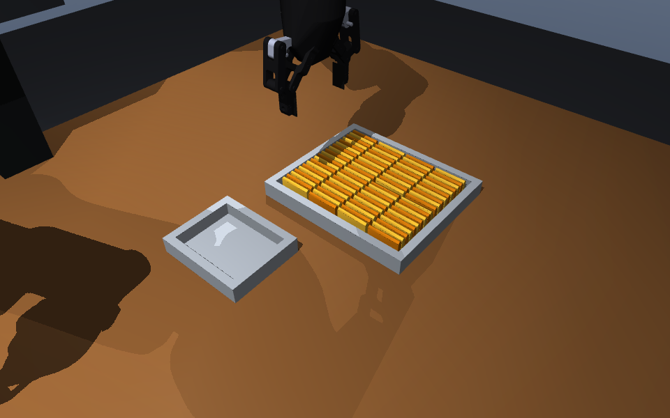 | 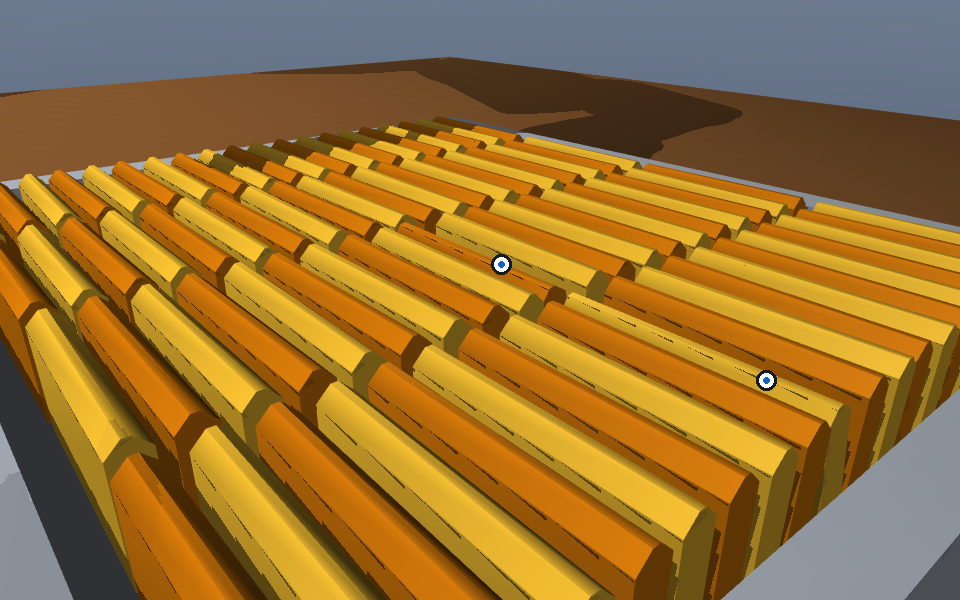 |

**5 回合测试：**

```bash
MUJOCO_GL=egl python -m a3_dual_arm_sim.workflows.benchmark_cookie_batch_cli \
  --task 2x10-tilted --protocol course-v1 \
  --policy expert --profile basic --episodes 5 --seed-start 0 \
  --workers 1 --output outputs/course_tests/2x10-tilted.json
```

**渲染专家演示：**

```bash
MUJOCO_GL=egl python -m a3_dual_arm_sim.workflows.benchmark_cookie_batch_cli \
  --task 2x10-tilted --protocol course-v1 \
  --policy expert --profile basic --episodes 1 --seed-start 0 \
  --workers 1 --render --output outputs/course_demos/2x10-tilted.json
```

## 13. 整列轻倾 2×5（whole-row-lean）

**基础 13/14** · seed=0 · basic · 源盒 80 块 · 目标盒 0 块

一个源列的物体同向轻倾；目标盒最终两列各 5 块。 图中第 3 源列轻倾约 10°；标记点位于该列。

**实际提示词：** `Fill the target box.`

| 工作区全景 | 源盒倾斜细节 |
| :---: | :---: |
| 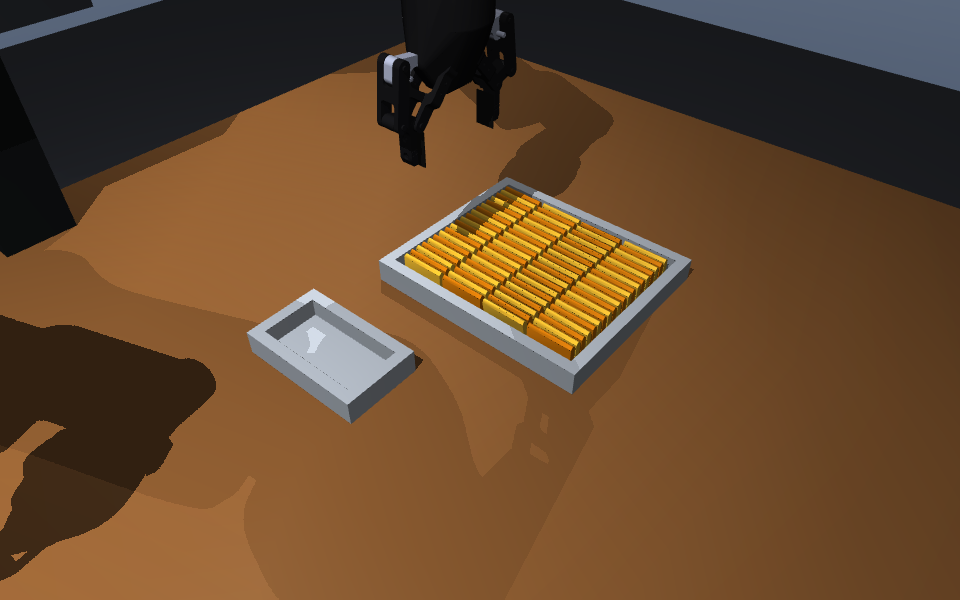 |  |

**5 回合测试：**

```bash
MUJOCO_GL=egl python -m a3_dual_arm_sim.workflows.benchmark_cookie_batch_cli \
  --task whole-row-lean --protocol course-v1 \
  --policy expert --profile basic --episodes 5 --seed-start 0 \
  --workers 1 --output outputs/course_tests/whole-row-lean.json
```

**渲染专家演示：**

```bash
MUJOCO_GL=egl python -m a3_dual_arm_sim.workflows.benchmark_cookie_batch_cli \
  --task whole-row-lean --protocol course-v1 \
  --policy expert --profile basic --episodes 1 --seed-start 0 \
  --workers 1 --render --output outputs/course_demos/whole-row-lean.json
```

## 14. 整列轻倾 2×10（2x10-whole-row-lean）

**基础 14/14** · seed=0 · basic · 源盒 80 块 · 目标盒 0 块

一个源列的物体同向轻倾；目标盒最终两列各 10 块。 图中第 3 源列轻倾约 10°；标记点位于该列。

**实际提示词：** `Fill the target box.`

| 工作区全景 | 源盒倾斜细节 |
| :---: | :---: |
| 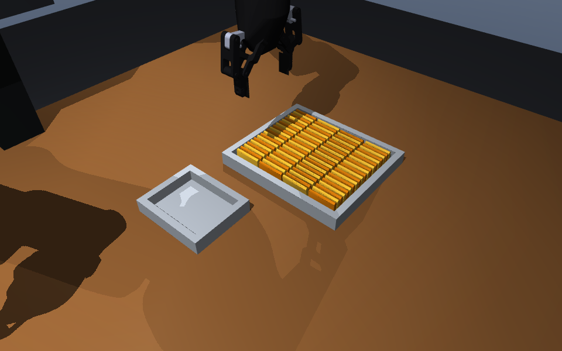 | 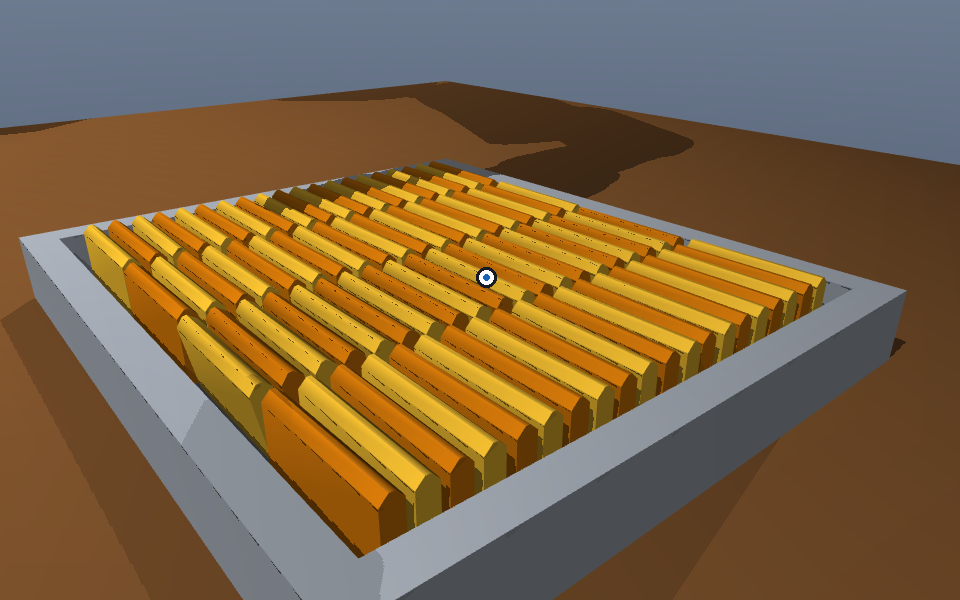 |

**5 回合测试：**

```bash
MUJOCO_GL=egl python -m a3_dual_arm_sim.workflows.benchmark_cookie_batch_cli \
  --task 2x10-whole-row-lean --protocol course-v1 \
  --policy expert --profile basic --episodes 5 --seed-start 0 \
  --workers 1 --output outputs/course_tests/2x10-whole-row-lean.json
```

**渲染专家演示：**

```bash
MUJOCO_GL=egl python -m a3_dual_arm_sim.workflows.benchmark_cookie_batch_cli \
  --task 2x10-whole-row-lean --protocol course-v1 \
  --policy expert --profile basic --episodes 1 --seed-start 0 \
  --workers 1 --render --output outputs/course_demos/2x10-whole-row-lean.json
```

## 15. 固定预填（prefilled）

**Bonus 01/04** · seed=0 · basic · 源盒 75 块 · 目标盒 5 块

目标盒初始已有 5 块，目标是使盒内最终两列各有 5 块。 图中目标盒初始有 5 块，源盒初始有 75 块。

**实际提示词：** `Fill the target box.`

| 工作区全景 | 目标区域细节 |
| :---: | :---: |
|  | 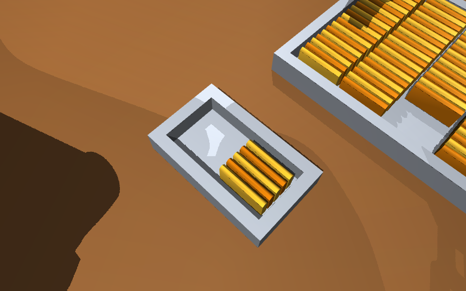 |

**5 回合测试：**

```bash
MUJOCO_GL=egl python -m a3_dual_arm_sim.workflows.benchmark_cookie_batch_cli \
  --task prefilled --protocol course-v1 \
  --policy expert --profile basic --episodes 5 --seed-start 0 \
  --workers 1 --output outputs/course_tests/prefilled.json
```

**渲染专家演示：**

```bash
MUJOCO_GL=egl python -m a3_dual_arm_sim.workflows.benchmark_cookie_batch_cli \
  --task prefilled --protocol course-v1 \
  --policy expert --profile basic --episodes 1 --seed-start 0 \
  --workers 1 --render --output outputs/course_demos/prefilled.json
```

## 16. 双目标盒（two-boxes）

**Bonus 02/04** · seed=0 · basic · 源盒 80 块 · 目标盒 0, 0 块

一个源盒对应两个目标盒，最终要求每个目标盒各有 5 块。 图中两个目标盒初始均为空，最终各放 5 块。

**实际提示词：** `Fill the target box.`

| 工作区全景 | 目标区域细节 |
| :---: | :---: |
| 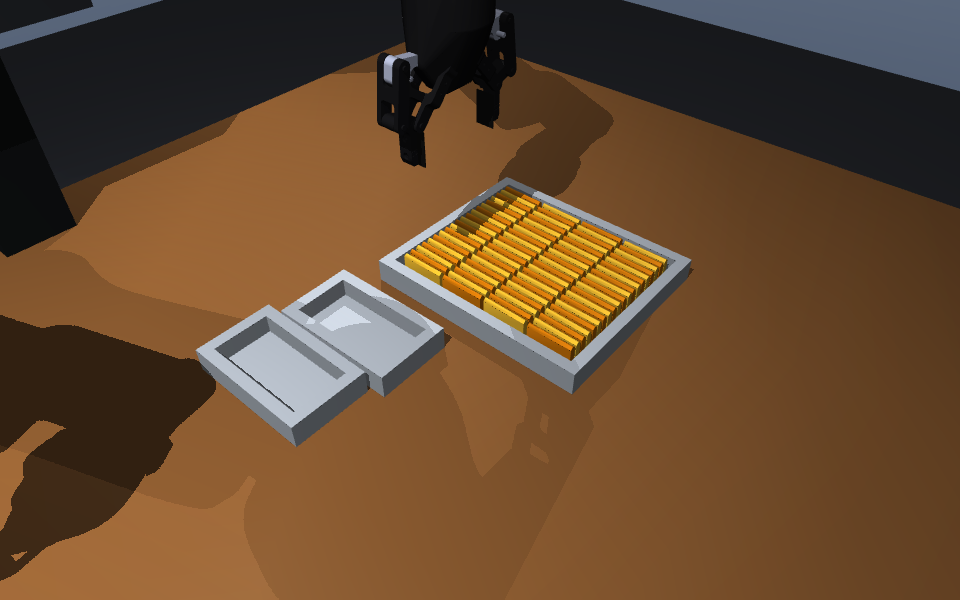 | 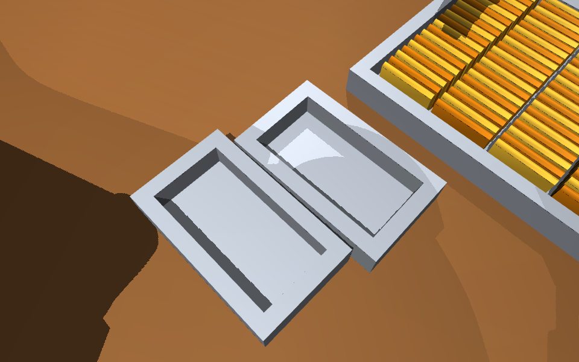 |

**5 回合测试：**

```bash
MUJOCO_GL=egl python -m a3_dual_arm_sim.workflows.benchmark_cookie_batch_cli \
  --task two-boxes --protocol course-v1 \
  --policy expert --profile basic --episodes 5 --seed-start 0 \
  --workers 1 --output outputs/course_tests/two-boxes.json
```

**渲染专家演示：**

```bash
MUJOCO_GL=egl python -m a3_dual_arm_sim.workflows.benchmark_cookie_batch_cli \
  --task two-boxes --protocol course-v1 \
  --policy expert --profile basic --episodes 1 --seed-start 0 \
  --workers 1 --render --output outputs/course_demos/two-boxes.json
```

## 17. 旋转目标盒（rotated-target）

**Bonus 03/04** · seed=0 · basic · 源盒 80 块 · 目标盒 0 块

目标盒水平旋转，最终仍需两列各放 5 块。 图中初始化抽取的目标盒旋转角为 -82.2°。

**实际提示词：** `Fill the target box.`

| 工作区全景 | 目标区域细节 |
| :---: | :---: |
| 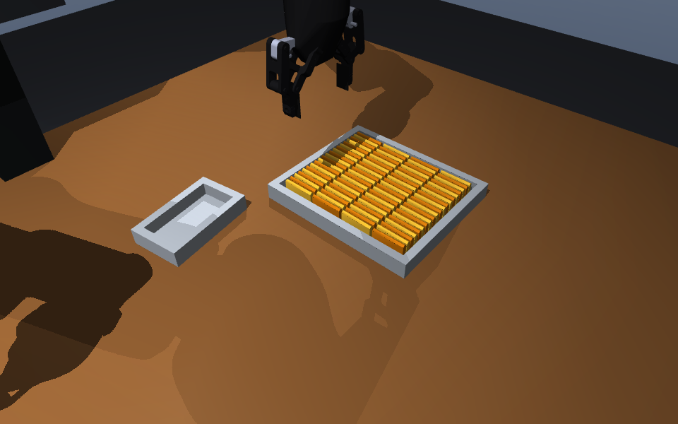 |  |

**5 回合测试：**

```bash
MUJOCO_GL=egl python -m a3_dual_arm_sim.workflows.benchmark_cookie_batch_cli \
  --task rotated-target --protocol course-v1 \
  --policy expert --profile basic --episodes 5 --seed-start 0 \
  --workers 1 --output outputs/course_tests/rotated-target.json
```

**渲染专家演示：**

```bash
MUJOCO_GL=egl python -m a3_dual_arm_sim.workflows.benchmark_cookie_batch_cli \
  --task rotated-target --protocol course-v1 \
  --policy expert --profile basic --episodes 1 --seed-start 0 \
  --workers 1 --render --output outputs/course_demos/rotated-target.json
```

## 18. 可变预填（variable-prefill）

**Bonus 04/04** · seed=0 · basic · 源盒 73 块 · 目标盒 7 块

目标盒初始随机放置 1–9 块，目标是使盒内最终两列各有 5 块。 图中目标盒初始有 7 块，本回合需补 3 块。

**实际提示词：** `Fill the target box.`

| 工作区全景 | 目标区域细节 |
| :---: | :---: |
| 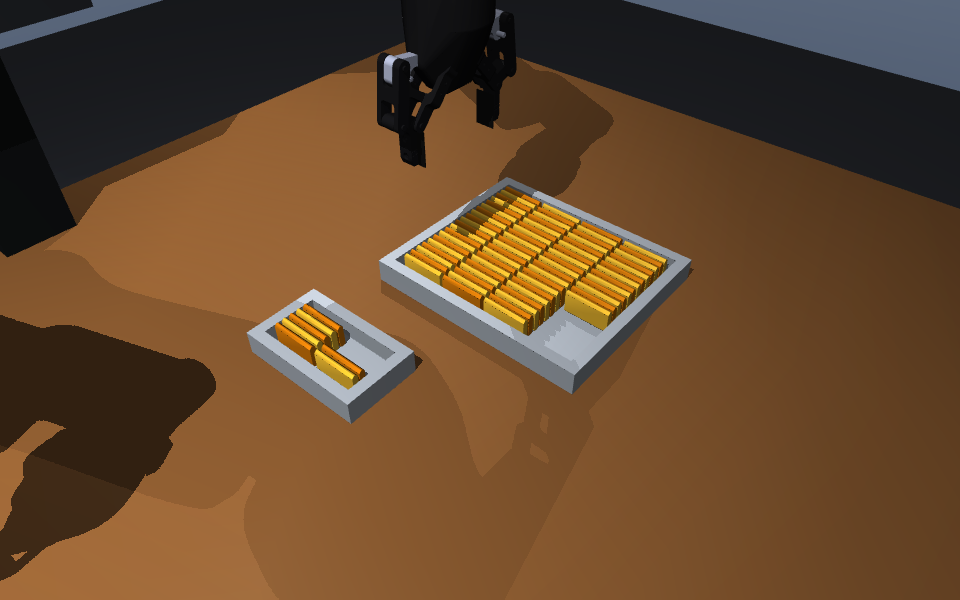 | 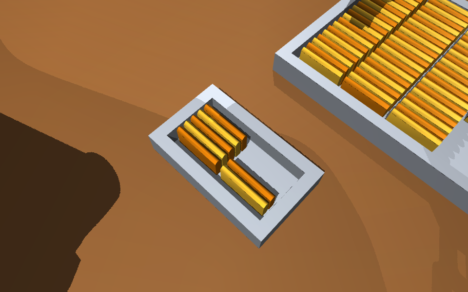 |

**5 回合测试：**

```bash
MUJOCO_GL=egl python -m a3_dual_arm_sim.workflows.benchmark_cookie_batch_cli \
  --task variable-prefill --protocol course-v1 \
  --policy expert --profile basic --episodes 5 --seed-start 0 \
  --workers 1 --output outputs/course_tests/variable-prefill.json
```

**渲染专家演示：**

```bash
MUJOCO_GL=egl python -m a3_dual_arm_sim.workflows.benchmark_cookie_batch_cli \
  --task variable-prefill --protocol course-v1 \
  --policy expert --profile basic --episodes 1 --seed-start 0 \
  --workers 1 --render --output outputs/course_demos/variable-prefill.json
```
