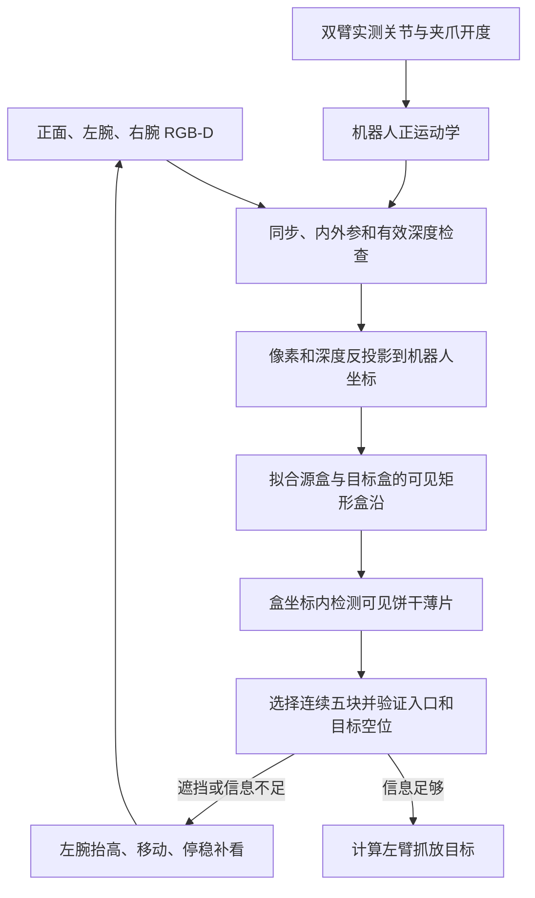

# V15 稳定版：三摄 RGB-D 定位与分批闭环抓放

V15 将一次完整任务拆成“观察与定位 → 抓五块 → 抬起后测量夹持偏差 → 放置与释放 → 复核 → 重新定位下一批”。本页重点说明定位的实现及其边界，并提供冻结代码和复现命令。

**这是经典 RGB-D 几何视觉控制器，不是 π0.5 的新检查点。**所报告实验没有加载、训练或修改 π0.5。V15 网格中右臂保持初始安全姿态；左臂负责主动观察和操作。后续版本的右臂主动观察、观察后撤回、历史视角记忆均不属于这份 V15 稳定版。

本目录的运行代码、视觉依赖、配置和原有测试与已验证的 `a3_sensor_complete_20261021_v15` 发布包逐字节一致。文档重新整理，并附上精简结果。原始文件哈希见 [provenance.json](provenance.json)，本目录当前文件哈希见 [manifest.json](manifest.json)。

## 1. 定位的数据流



这里有两个不同的问题：**标定回答相机在哪里，检测回答物体在哪里。**三摄的结果只有进入同一机器人坐标系后才能比较和使用。

### 1.1 输入、相机分工和坐标变换

| 输入 | 在定位中的用途 |
| --- | --- |
| 正面 RGB-D | 整体盒体与排列信息；不保证始终看清薄片和入口 |
| 左腕 RGB-D | 近距离看饼干、源区入口、目标空位及放置结果；可随左臂移动补看 |
| 右腕 RGB-D | 标定及可见性合格时提供额外证据；V15 不主动移动右臂 |
| 实测关节与夹爪开度 | 更新腕相机外参、末端位置与夹爪状态；不是物体状态 |
| 公开尺寸和标定量 | 饼干与盒体尺寸、规则排列、目标槽位、桌面高度、机器人模型与相机名义安装 |

V15 在三个原有相机安装位置采集对齐的 768×768 RGB-D。米制深度是相对原 RGB 策略增加的传感模态，不能将这里的结果等同于纯 RGB 模型的结果。相机并非总是三路都有效：无法确认标定的视角会将深度屏蔽为未知，不会强行参与融合。

对像素中心 `(u+0.5, v+0.5)`，使用该像素深度 `z` 和内参 `K` 计算：

```text
p_camera = z · inverse(K) · [u+0.5, v+0.5, 1]
p_base   = R_base_camera · p_camera + t_base_camera
T_base_camera(q) = T_base_end_effector(q) · T_end_effector_camera
```

最后一个式子解释了移动腕部后为什么还能定位：相机安装关系经过标定，当前末端位姿由实测关节和 FK 得到。机器人运动学在独立数据中计算，不读取场景内饼干的位置。完整变换实现见 [`rgbd.unproject`](code/vendor/a3_batch_skills/rgbd.py)、[`NominalRobotCalibration.update`](code/a3_continuability/three_camera_sensor.py)。

### 1.2 开头左臂移动几下：多姿态手眼标定

初始相机安装参数可能有偏差，因此开头先校准。标定物是**已知尺寸、位置尚待估计的静止矩形源盒盒沿**，不是读取源盒的真实位姿。

1. 从有效 RGB-D 中粗定位源盒盒沿；先抬高夹爪，再规划多个安全观察姿态。
2. 改变左腕俯仰、侧倾并加入少量平移，停稳后保存配对的实测末端位姿和图像。
3. 用盒沿几何估计每次相机到盒沿的变换，至少需要五个有效视角及足够的旋转轴变化。
4. 调用 OpenCV `calibrateHandEye` 的 Park 方法求解相机到末端的安装变换；结合已知矩形尺寸检验焦距尺度。
5. 检查不同视角重建的静止盒沿是否一致，并用留出视角验证；不合格时拒绝标定。
6. 用校准后的左腕观察到的同一盒沿，锚定其他能看清该盒沿的相机。不能完成锚定的相机仍保持未知深度。

代码中的 2 mm 拟合残差、3 mm 留出残差等是**标定接受阈值**，不是整套系统已实现相应绝对定位精度的证明。桌面平面用于法向和高度修正；桌面本身不能独立确定水平平移和偏航。

实现：[`handeye_calibration.py`](code/a3_continuability/handeye_calibration.py)、[`install_handeye`](code/a3_continuability/three_camera_sensor.py)、[`plane_calibration.py`](code/a3_continuability/plane_calibration.py)。

### 1.3 先定位盒子：可见盒沿拟合

系统把 RGB-D 反投影为点云，根据浅色外观和高度区间提取盒沿候选，再在水平面拟合矩形，结合公开尺寸估计盒体中心、偏航和盒沿高度。普通定位至少需要三条有几何支持的边；手眼标定要求四条边。只有一端被遮挡时可以利用已知尺寸约束中心，不能在大范围不可见时凭空补出整个盒子。

三视角分别提出估计，优先选择几何支持较好的结果；不同相机的完整盒体估计若相差超过 5 mm 或 2°，定位会拒绝并要求重新观察，而不是盲目平均。不同视角也可以分别支持源盒和目标盒，腕部画面无需同时包含两个完整盒子。

实现：[`RGBDLocalizer._boxes`](code/vendor/a3_batch_skills/rgbd_localization.py)、[`ThreeViewLocalizer.observe`](code/a3_continuability/three_view_localizer.py)。

### 1.4 再定位饼干：几何检测与排列先验

V15 没有使用通用目标检测或六自由度姿态网络。检测器在已拟合的盒坐标中，按颜色差异、顶部高度、薄片宽度、可见覆盖和表面起伏筛选真实可见的饼干表面。当前颜色门限是较宽的色度差异约束，并非只识别单一橙色。

| 量 | 当前估计方式及约束 |
| --- | --- |
| 源区横向位置 `x` | 由已定位盒体和已知列排列约束；不是独立、自由测量的每块饼干横向位置 |
| 源区排列方向位置 `y` | 从当前可见薄片的深度点分布测量 |
| 源区高度 `z` | 从当前可见顶部深度与已知饼干高度估计 |
| 源区方向 | 沿用盒体方向及饼干基本直立的假设；不是任意姿态检测 |
| 目标区饼干中心 | 从可见矩形顶部测量中心与高度，并检查尺寸和覆盖 |

同一相机内先形成完整可见实例，再跨视角去重、检查匹配偏差并补充遗漏实例。不会先把多路有细微标定误差的薄片点云混成一个直方图，否则相邻薄片容易被抹宽或合并。看不到的饼干不会仅凭排列先验补出来，少于五块或中间有缺口时不能组成虚构的五块抓取。

实现：[`slab_instances.py`](code/a3_continuability/slab_instances.py)、[`three_view_localizer.py`](code/a3_continuability/three_view_localizer.py)、[`select_visible_five`](code/vendor/a3_batch_skills/rgbd_localization.py)。

### 1.5 不只定位饼干，还要确认入口和目标区域可用

“没有检测到饼干”不等于“区域为空”。控制器在源区进入通道和目标区域采样盒底点，投影到当前有效深度图；只有量到的深度与预期盒底吻合，才记为正向空闲证据。

当前多视角对同一区域的有效证据取并集。入口和目标区域的盒底可见覆盖都需达到 90%；该比例是采样点覆盖率，**不是 90% 定位准确率，也不是成功概率**。无效、越界、被物体或手臂挡住的射线均不能作为空位证据。

目标放置槽是公开任务几何，以**视觉测出的目标盒位姿**转换到机器人坐标；它不是目标盒随机化后的真实位置。源饼干抓取中心来自当前可见的五块，入口和放置区域还须通过上述检查。

实现：[`floor_visibility` / `make_visual_goal`](code/vendor/a3_batch_skills/visual_goals.py)、[`choose_pick`](code/a3_continuability/sensor_batch_loop.py)。

### 1.6 后面左臂移动补看，与开头标定的区别

| 时机 | 解决的问题 | 具体行为 |
| --- | --- | --- |
| 回合开始 | 相机安装关系是否准确 | 多姿态手眼标定，反复观察静止盒沿 |
| 抓取前入口看不清 | 夹爪前方是否有进入空间 | 移到源区入口上方，停稳后重新取图和定位 |
| 目标区域看不清 | 预定放置区域是否为空 | 移到相应目标区域上方，尝试小范围不同观察位置 |
| 撤离后 | 本批及此前批次是否保留 | 移到验证视角，用当前图像复核 |

补看根据缺失的信息选择观察区域，经过实际左臂运动、关节反馈更新外参后重新拍摄；不是传送相机、改变场景或读取被遮挡物体的位置。观察位姿需要满足安全高度、可达性、视场和停稳条件，仍看不清则有界重试并报失败。

V15 的实时融合只使用同步当前视角，没有 V18 的历史画面补全。每批边界会重新检查平面标定和定位，不会每批重跑开头的整套多姿态手眼标定。正常控制步持续读取关节反馈；RGB-D 通常每两个控制步刷新，阶段边界会强制刷新，完整场景拟合主要发生在定位/验证阶段，并非每一步都重新拟合全部物体。

实现：[`observe_goal` / `start_observation`](code/a3_continuability/sensor_batch_loop.py)、[`needs_sensor_refresh`](code/a3_continuability/sensor_boundary.py)。

### 1.7 抓起之后再测一次，修正实际夹持偏差

抓取目标准确不代表夹持后的饼干与夹爪关系完全符合计划。抬起后，V15 在夹爪附近的点云中检查五块悬空薄片及其几何特征，估计饼干相对末端的实际偏移和旋转，再据此计算放置末端目标。它不是继续假设饼干始终位于计划的夹爪中心。

实现：[`held_batch_vision.py`](code/a3_continuability/held_batch_vision.py)、[`fit_held`](code/a3_continuability/sensor_batch_loop.py)。

## 2. 定位功能的适用范围与信息边界

**控制使用：**三路渲染 RGB-D、同步时间、机器人实测关节/夹爪开度、CAD/FK/IK、相机名义安装和观测标定、测量桌面高度、公开盒体/饼干尺寸、规则列排列和目标槽位。

**控制不使用：**随机生成后的饼干/盒体真实位姿、物体实例 ID、接触对象图、当前 benchmark 得分或成功标志。原生评测器可以读取这些真值打分，但结果不反馈给目标选择、批次切换或释放决策。

因此“未输入物体真值”不等于“没有先验”。本定位器面向已知尺寸、浅色矩形盒、规则排列和基本直立饼干；未知盒型、任意散乱排列、强倾倒、真实深度噪声/空洞/反光及硬件延迟尚未得到验证。现有包里保留了部分其他实验的辅助函数；本页的信息边界指下述 `NativeSensorPolicy → SensorBatchLoop → ThreeViewLocalizer` 执行路径，不应把整个依赖包的任意函数当作同一协议。

V15 每批完成后清理当前目标与局部状态，再定位剩余物体，同时保留已完成区域的复核记录。这会减少旧定位偏差被继续使用，但不会物理重置场景，也不能自动消除已发生的碰歪或接触误差。

## 3. 其余抓放流程与 V15 改动摘要

完整顺序为：`LOCATE → APPROACH → PRE_CLOSE → DESCEND → PINCH → LIFT → HELD → TRANSPORT → PREINSERT → INSERT → OPEN → RETREAT → VIEW → VERIFY`，通过后进入下一批。

V15 的 `--refine` 开关加入三项稳定性改进：观察根据实际视场与关节停稳结束；插入在有连续视觉放置证据和有界末端误差时允许释放；小步 IK 使用更细求解容差和有界关节目标变化。未提供该开关时保留原条件，便于对照。操作仍有超时；视觉确认检查本批和此前批次的可见位置/高度与稳定性，不能替代 main 原生姿态和成功判据。

控制器产生左臂七关节加夹爪的 8D 目标；原生接口需要 16D 时，拼接初始安全右臂目标。右臂闲置不是发送全零关节位置。

## 4. 已完成的仿真结果

以下为 **2026-10-22 08:15:31 UTC（北京时间 16:15:31）核验的已完成记录**，不是本次文档整理重新跑出的结果。每格 20 回合，无基础设施错误。

| 任务 | 随机化 | main 原判据通过 | 释放后视觉确认通过 | 平均最终有效数量 |
| --- | --- | ---: | ---: | ---: |
| 2×5 | medium | 20/20（100%） | 20/20（100%） | 10.00/10 |
| 2×5 | advanced | 20/20（100%） | 19/20（95%） | 10.00/10 |
| 2×10 | medium | 9/20（45%） | 9/20（45%） | 17.15/20 |
| 2×10 | advanced | 10/20（50%） | 10/20（50%） | 17.50/20 |

2×5 合计 main 40/40、释放确认 39/40；2×10 两项均为 19/40。2×5 advanced 的一个回合虽然 main 已记录成功并有 10 块有效饼干，但控制器最终在 INSERT 超时，不能计作已完成额外释放确认。

协议：固定 main 提交 `29fe90e423259f388ebc061926c3ec860b9edc74`，来源第 1 列，每夹五块；2×5 两批/1500 步，2×10 四批/3000 步，含标定和主动观察。保持原相机安装及原成功判据；关闭成功后的立即终止，以便继续完成释放后确认。main 成功计数沿用其原生字段，与额外确认分开报告。

2×5 使用开发中已见过的 15000–15019，因此是回归结果；2×10 使用当时新开的 16000–16019。2×10 最常见失败为后续目标空位缺乏可见证据，其次为插入超时或此前成果验证失败。完整可机读汇总见 [results/v15_grid_summary.json](results/v15_grid_summary.json)。这些数据不证明纯 RGB VLA、任意盒型泛化或实机性能。

## 5. Linux 复现

需要 Python 3.12、可用的 MuJoCo EGL 渲染驱动及本目录 [requirements-tested.txt](requirements-tested.txt) 中的数值/渲染依赖。原测试使用的精确依赖版本随包提供；不需要下载 π0.5 权重或数据集。

本次发布前在既有 Linux 环境重新通过 42 项测试、45 个 Python 文件编译检查和 3 个命令行帮助入口检查。记录见 [publication_validation.json](results/publication_validation.json) 和 [unit_tests.log](results/unit_tests.log)。本次没有重跑完整抓放网格，上表保留原有已完成记录。

### 5.1 获取本分支及固定模拟器

本分支基于发布时的 main，V15 代码独立保存在 `examples/sensor_v15/`。为保持已报告结果的来源一致，**运行时另用一个干净的固定提交克隆**，不能把当前分支 HEAD 当作旧模拟器提交传给准备工具。

```bash
git clone --branch codex/v15-rgbd-localization --single-branch \
  https://github.com/Eter0109/a3_dual_arm_sim.git a3-v15
cd a3-v15
export A3_V15_BUNDLE="$PWD/examples/sensor_v15"

# 使用新的工作目录；下面的名称可按机器修改。
export A3_V15_WORK="$HOME/a3-v15-work"
mkdir -p "$A3_V15_WORK"
git clone https://github.com/Eter0109/a3_dual_arm_sim.git "$A3_V15_WORK/simulator"
git -C "$A3_V15_WORK/simulator" checkout 29fe90e423259f388ebc061926c3ec860b9edc74

python3.12 -m venv "$A3_V15_WORK/venv"
source "$A3_V15_WORK/venv/bin/activate"
python -m pip install --upgrade pip
python -m pip install -r "$A3_V15_BUNDLE/requirements-tested.txt"
python -m pip install -e "$A3_V15_WORK/simulator"

python "$A3_V15_BUNDLE/prepare_workspace.py" \
  --job "$A3_V15_WORK/job" --main-repo "$A3_V15_WORK/simulator"
source "$A3_V15_WORK/job/repro_env.sh"
export PYTHONPATH="$A3_V15_BUNDLE/code:$A3_V15_BUNDLE/code/vendor${PYTHONPATH:+:$PYTHONPATH}"
python -m unittest discover -s "$A3_V15_BUNDLE/tests" -v
```

准备工具只链接模拟器并复制小型相机配置和确定性辅助代码；不要向它提供模型参数。本目录随带的 `runtime.py` 中存在其他研究使用的模型函数，但本页网格入口不会调用它们。

### 5.2 先跑一个回合，再跑完整网格

```bash
python "$A3_V15_BUNDLE/code/run_main_sensor_grid.py" \
  --job "$A3_V15_WORK/job" --skill-code "$A3_V15_BUNDLE/code/vendor" \
  --output "$A3_V15_WORK/outputs/smoke_2x5" \
  --tasks 2x5 --profiles medium --episodes 1 --seed-start 15000 --workers 1 \
  --table-height .75 --handeye --refine

python "$A3_V15_BUNDLE/code/run_main_sensor_grid.py" \
  --job "$A3_V15_WORK/job" --skill-code "$A3_V15_BUNDLE/code/vendor" \
  --output "$A3_V15_WORK/outputs/grid_2x5" \
  --tasks 2x5 --profiles medium advanced --episodes 20 --seed-start 15000 --workers 2 \
  --table-height .75 --handeye --refine

python "$A3_V15_BUNDLE/code/run_main_sensor_grid.py" \
  --job "$A3_V15_WORK/job" --skill-code "$A3_V15_BUNDLE/code/vendor" \
  --output "$A3_V15_WORK/outputs/grid_2x10" \
  --tasks 2x10 --profiles medium advanced --episodes 20 --seed-start 16000 --workers 2 \
  --table-height .75 --handeye --refine
```

示例的 `.75` 是本仿真场景桌面高度，实机必须替换为测量与标定结果。增加 `--profiles basic medium advanced` 可覆盖三档，但 basic 不属于上表所列结果。每个输出目录必须唯一；同代码、同参数、同输出增加 `--resume` 可续跑，活动目录有进程锁。后台运行可使用 `nohup`，先确认单回合正常再增加并行度。

结果写入输出目录中的 `status.json`、`report.json`、`summary.md` 和 `results.jsonl`；每回合诊断在 `cases/` 下。保存有限标定样本、日志及失败 RGB-D，不保存全量视频、模型检查点或物理快照。环境版本、渲染驱动或并行行为改变时应重新核验，不能保证跨硬件逐帧完全一致。

## 6. 代码阅读顺序

| 文件 | 阅读重点 |
| --- | --- |
| [`sensor_boundary.py`](code/a3_continuability/sensor_boundary.py) | 输入白名单、时间同步、实测夹爪状态及动作维度 |
| [`three_camera_sensor.py`](code/a3_continuability/three_camera_sensor.py) | 三路 RGB-D、名义安装、编码器 FK 和标定修正 |
| [`handeye_calibration.py`](code/a3_continuability/handeye_calibration.py) | 左腕多姿态观察与手眼求解 |
| [`rgbd.py`](code/vendor/a3_batch_skills/rgbd.py) | 米制深度反投影与静态公开几何配置 |
| [`rgbd_localization.py`](code/vendor/a3_batch_skills/rgbd_localization.py) | 矩形盒沿、可见实例与连续五块选择 |
| [`slab_instances.py`](code/a3_continuability/slab_instances.py) | V15 实际采用的薄片检测与排列约束 |
| [`three_view_localizer.py`](code/a3_continuability/three_view_localizer.py) | 跨视角一致性检查和实例补充 |
| [`visual_goals.py`](code/vendor/a3_batch_skills/visual_goals.py) | 盒底射线验证、抓取入口和目标空位 |
| [`held_batch_vision.py`](code/a3_continuability/held_batch_vision.py) | 空中五块检测与实际夹持偏差补偿 |
| [`sensor_batch_loop.py`](code/a3_continuability/sensor_batch_loop.py) | 主动补看、抓放状态机与逐批重新定位 |
| [`native_sensor_policy.py`](code/a3_continuability/native_sensor_policy.py) | 原生 `module:factory` 接口及安全右臂保持 |
| [`run_main_sensor_grid.py`](code/run_main_sensor_grid.py) | 固定预算网格、断点恢复、结果落盘 |

可复用到实机的核心是“标定 → RGB-D 几何 → 可见性检查 → 主动补看 → 重新定位”的接口与流程。当前仍是仿真验证；实机还需完成相机内外参、RGB/深度配准、同步、真实深度质量和夹爪开度反馈验收。
